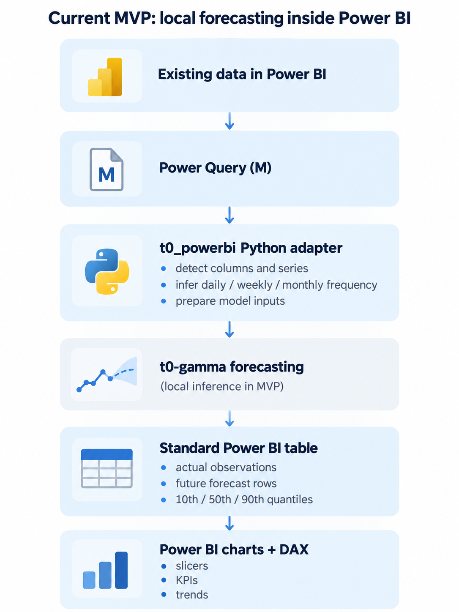
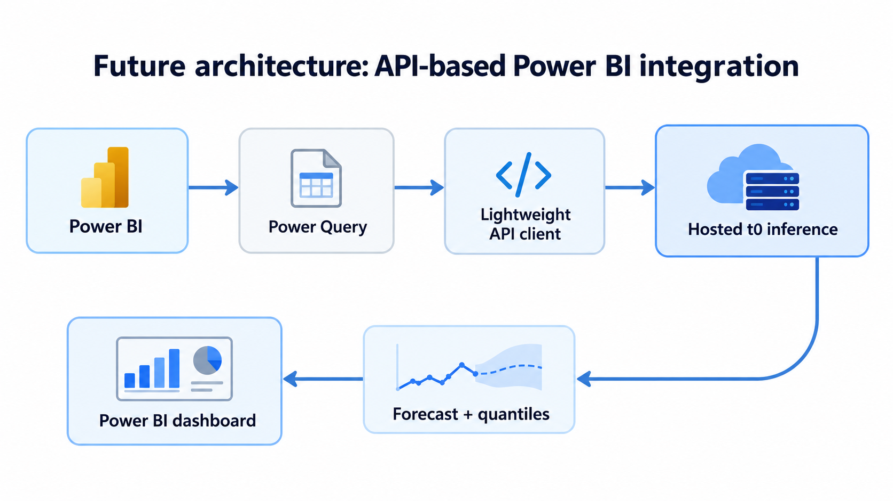

# t0 × Power BI

### Foundation-model forecasting, directly in the business intelligence workflow.

**A working integration prototype that brings [The Forecasting Company's t0](https://www.theforecastingcompany.com/) into Microsoft Power BI.**

Instead of asking analysts to export data, run a separate forecasting tool, and import the results, this project connects **Power Query → t0 → Power BI**. Users can refresh their data, explore forecasts by store or product, and view uncertainty alongside their existing business metrics—all inside a familiar dashboard.

**[▶ Watch the 3-minute demo](https://youtu.be/c0pWl_tuQ1o)** · [Setup guide](powerbi/dashboard_guide.md) · [Power Query scripts](powerbi/queries/)

[](https://youtu.be/c0pWl_tuQ1o)

*Working Power BI Desktop report using weekly sales from 45 Walmart stores. The dashboard combines historical sales, a 30-week forecast, a quantile band, a store selector and business KPIs.*

> **The contribution is the integration, not a new forecasting model.** This repository uses the official `tfc-t0` runtime and focuses on making a time-series foundation model usable through Power BI. Inference runs locally in this proof of concept; an API-backed integration is a natural next step, **not a feature implemented here**.

## Why Power BI?

Forecasting models are useful only if their outputs reach the people making decisions. In many businesses, those people already work in Power BI.

Microsoft reported **30 million monthly active Power BI users** and adoption across **more than 375,000 organizations** in its [2025 Power BI recap](https://community.fabric.microsoft.com/blog/fbc_pbiupdatesblog/power-bi-2025-holiday-recap-a-decade-of-innovation-and-impact/5173964).

That makes Power BI an interesting way to distribute advanced forecasting capabilities without asking users to adopt an entirely new application.

| Typical forecasting workflow | With this prototype |
| --- | --- |
| Export a table to CSV or a notebook | Use a table already loaded in Power Query |
| Prepare each new dataset manually | Automatically detect common date, value and series columns |
| Run a model outside the BI environment | Trigger forecasting during a Power BI refresh |
| Reimport predictions into a report | Receive a regular Power BI table with history and forecast |
| Interpret model output separately | Explore quantiles, trends and KPIs in the same dashboard |

**The goal:** make forecasting another step in the analytics workflow, rather than a separate workflow of its own.

## What I built

- **Power Query integration:** M queries and a short Python step connect Power BI tables to the forecasting runtime.
- **Dataset adaptation:** a Python package (`t0_powerbi`) infers common date, target, series-ID and frequency fields, so demo datasets do not need to follow a fixed naming convention.
- **Multi-series forecasting:** a single refresh can forecast multiple stores, products or other groups.
- **Power BI-friendly output:** historical observations and future quantiles are returned as a normal table, ready for Power BI visuals and DAX measures.
- **Interactive demonstration dashboard:** store selector, historical trends, median forecast, 10th–90th quantile band and KPI cards for demand, change, uncertainty, volatility and peak period.
- **Reproducible local setup:** `install.ps1` prepares Python, installs dependencies and downloads the model once.

The integration uses **Power BI's existing Power Query + Python capabilities**. It is not yet a native Power BI connector or a custom visual.

## How it works



The core Python step is deliberately small:

```python
from t0_powerbi import for_power_bi, forecast_dataframe

forecast = forecast_dataframe(dataset, horizon=30, include_history=True)
forecast = for_power_bi(forecast)
```

Here, `dataset` is the dataframe provided by Power Query. The adapter handles the conversion between BI data and the forecasting runtime; the model output is formatted so it can be loaded into Power BI like any other query result.

**Refresh vs. interaction:** clicking **Refresh** reruns the forecast. Changing the store selector only filters the forecast rows already loaded; it does not trigger a new model call.

### Output schema

| Column | Meaning |
| --- | --- |
| `date` | Historical or future period |
| `series_id` | Store, product or other detected series (or `All` for a single series) |
| `kind` | `actual` or `forecast` |
| `actual` | Observed value, populated on historical rows |
| `forecast` / `p50` | Median forecast (50th quantile) |
| `p10` / `p90` | 10th and 90th forecast quantiles |

Missing values in forecast-only or actual-only columns are intentional. History and forecast are kept in **one table** to simplify report building. The column names `p10`, `p50` and `p90` are part of the current code interface; the dashboard presents them as **quantiles**.

## Try it in Power BI Desktop

### 1. Install locally

**Requirements:** Windows, Power BI Desktop and Python 3.10–3.13 (tested with Python 3.11). A GPU is not required.

```powershell
# Replace YOUR_USERNAME with the repository owner.
git clone https://github.com/YOUR_USERNAME/t0-powerbi.git
cd t0-powerbi
powershell -ExecutionPolicy Bypass -File .\install.ps1
```

The installer creates `.venv`, installs `t0_powerbi` and its dependencies, downloads the `t0-gamma` weights (approximately 1 GB), runs a sample forecast and prints the Python environment directory to configure in Power BI.

After the first download, **this demo runs inference locally**. The local design makes the prototype reproducible; it is not a statement that hosted/API inference should be avoided.

### 2. Connect Power BI

Follow the detailed [dashboard setup guide](powerbi/dashboard_guide.md). In short:

1. In Power BI Desktop, configure **Python scripting** to use this project's `.venv\Scripts` directory, and apply the privacy configuration described in the guide.
2. Add the three queries from [`powerbi/queries/`](powerbi/queries/): `DataFile` (source CSV path), `Data` (input table) and `Forecast` (the Python forecasting step).
3. Load the result, then create the provided measures and visuals.
4. To try another CSV, change the path in `DataFile` and click **Refresh**.

The included queries are configured for a CSV demo, but the adapter is designed to accept a suitable Power Query dataframe. Integrations with arbitrary Power BI data sources have not been fully validated.

### 3. Bring your own dataset

The adapter is intended for **common daily, weekly and monthly time-series tables**. It tries to infer:

| Field | Default behavior |
| --- | --- |
| Date | Detects dates, including common text date formats |
| Target | Prefers numeric fields named like sales, revenue, amount or units |
| Series | Uses suitable store, SKU, product or other ID fields; combines multiple group fields when needed |
| Frequency | Infers daily, weekly or monthly spacing from timestamps |

If automatic detection is not appropriate, configure `DATE_COL`, `VALUE_COL`, `ID_COLS` or `FREQ` in [`powerbi/power_query_script.py`](powerbi/power_query_script.py).

Missing time periods are passed as missing values rather than interpolated, and multiple rows in the same period are summed. For incomplete weekly or monthly periods, `DROP_LAST_PERIODS = 1` can prevent a partial final observation from distorting the forecast.

## Demo dataset: Walmart weekly sales

The example uses [`examples/Walmart_Sales.csv`](examples/Walmart_Sales.csv), a store-level retail dataset that makes the integration easy to explore.

| Property | Value |
| --- | --- |
| Stores | 45 independent store series |
| Observations | 6,435 rows (143 weeks per store) |
| Coverage | 5 February 2010 to 26 October 2012 |
| Target | `Weekly_Sales` |
| Date input | `Date`, stored as `dd-mm-yyyy` text |
| Additional fields | `Holiday_Flag`, `Temperature`, `Fuel_Price`, `CPI`, `Unemployment` |

The current demo **forecasts from sales history only**; the additional fields are not passed as future covariates. The dataset is useful for demonstrating multi-series selection, weekly frequency detection, visible seasonality and forecast uncertainty **within Power BI**, rather than for claiming state-of-the-art forecasting accuracy.

*Data provenance:* the file appears to match a Walmart store-level dataset commonly circulated on Kaggle. Its original license and provenance have not been independently verified; verify redistribution rights before publishing the CSV.

## From local prototype to a hosted API integration

The current implementation validates the **Power BI user experience** with the official local `tfc-t0` runtime. A production-oriented version could keep the same BI interface while replacing local inference with a hosted API from The Forecasting Company:



Potential benefits include centralized model serving, simpler client installation and usage managed through API authentication and billing. **This API path is a proposal, not an implemented or tested integration.**

Possible next steps:

- Build an API-backed adapter while preserving the same Power BI output schema.
- Expose horizon, target and quantile configuration more directly in the Power BI interface.
- Package the workflow as a more native Power Query connector.
- Explore scheduled refresh via a Power BI gateway, then validate service deployment.
- Add optional covariates and backtesting views to the dashboard.

## Current scope and limitations

This is a **working Desktop proof of concept**, not a production Power BI connector.

- **Validated in Power BI Desktop:** local Python environment, `DataFile` / `Data` / `Forecast` queries, report visuals and dataset switching with the Walmart and synthetic demo data.
- **Refresh cost:** Power BI starts a new Python process for the step, so the model is loaded from disk on each refresh. Power Query may evaluate a query more than once during editing.
- **Input scope:** daily, weekly or monthly series; one numeric target per run; no covariates in the current forecast.
- **Quantile scope:** quantiles are computed per series. Summing individual series' lower or upper quantiles does **not** produce the corresponding quantile for an aggregate; the demo slicer is single-select.
- **Deployment:** Power BI Service scheduled refresh, gateway setup and GPU inference have not been validated.
- **Scale:** on a Ryzen 7 5700X (CPU), the original demo measured approximately 5 seconds for 45 series of 143 observations in a fresh process, with approximately 2.2 GB peak RAM.

## Repository structure

```text
src/t0_powerbi/           Dataset preparation, model loading, forecasting
powerbi/                 Power Query scripts, query generator, dashboard guide
powerbi/queries/         DataFile, Data and Forecast (M queries)
examples/                Walmart and synthetic demo data
screenshots/             Power BI dashboard screenshot
install.ps1              Windows environment setup
```

## Credits

The forecasting model **t0 / t0-gamma** was developed by [The Forecasting Company](https://www.theforecastingcompany.com/). This project is an independent Power BI integration prototype built around the official [`tfc-t0`](https://github.com/theforecastingcompany/tfc-t0) Python package; it does **not** claim authorship of the model.

Model: [t0-gamma on Hugging Face](https://huggingface.co/theforecastingcompany/t0-gamma) · Paper: [*t0: A Time-Series Foundation Model for Forecasting with Context*](https://arxiv.org/abs/2609.24559)

Before redistributing code, model weights or example data, check the relevant upstream and dataset license terms.
