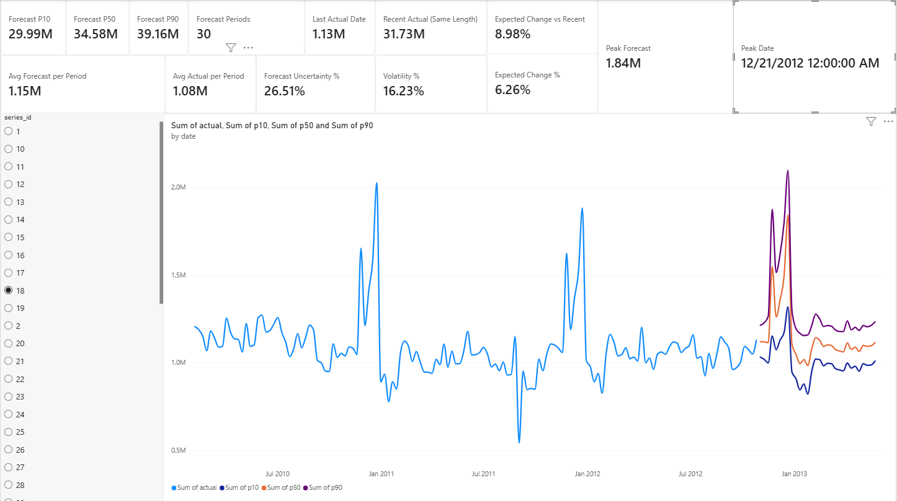

# t0-powerbi

**Probabilistic forecasts from [t0-gamma](https://huggingface.co/theforecastingcompany/t0-gamma), running locally inside Power BI Desktop.**

Load a table in Power BI, click **Refresh**, and get P10 / P50 / P90 forecasts for every series in it. Power
Query hands the table to Python, the official [`tfc-t0`](https://github.com/theforecastingcompany/tfc-t0)
runtime forecasts on your own machine, and the result comes back as a regular Power BI table. No API key, no
cloud inference, no server, no CSV to export by hand.



*Power BI Desktop, Walmart store 18: weekly sales history, 30-week t0-gamma forecast with its P10–P90 band,
and KPI cards. The model puts the peak in the week of 21 December 2012 without being told about holidays.*

**Demo video:** https://youtu.be/c0pWl_tuQ1o

## What was built

- A small Python package, `t0_powerbi`, that takes any table with a date column and a numeric column and
  returns forecasts. It finds the columns, the series (store, product, ...) and the frequency (daily, weekly or
  monthly) by itself, so nothing has to be renamed.
- A script to paste into Power Query's **Run Python script**, and ready-made Power Query (M) queries that wire it up.
- A Power BI report built on one table: history and forecast together, a series slicer, a chart with the
  P10–P90 band, and KPI cards (expected demand, expected change, forecast uncertainty, volatility, peak).
- `install.ps1`, which sets up the environment and downloads the model once.

```text
 Power BI Desktop
   │  Data query (CSV, Excel, SQL, ...)
   ▼
 Power Query ── "Run Python script" ──►  dataset (pandas DataFrame)
                                            │
                                            ▼
                              t0_powerbi.forecast_dataframe
                               ├─ detect date / value / series columns and frequency
                               ├─ load t0-gamma from the local Hugging Face cache (CPU or GPU)
                               └─ T0Forecaster.predict  →  P10 / P50 / P90
                                            │
 Power Query  ◄──────── one table: history + forecast
   ▼
 Report: chart, slicer, KPI cards
```

The pasted script is short:

```python
from t0_powerbi import for_power_bi, forecast_dataframe

forecast = forecast_dataframe(dataset, horizon=30, include_history=True)
forecast = for_power_bi(forecast)
```

| column | meaning |
| --- | --- |
| `date` | period of the row (a forecast starts one period after each series' own last date) |
| `series_id` | the series: a store, a product, `Geneva \| Café`, or `All` when the table has no id column |
| `kind` | `actual` (observed) or `forecast` (future) |
| `actual` | the observed value, on `actual` rows only |
| `forecast`, `p10`, `p50`, `p90` | t0-gamma's quantiles, on `forecast` rows only (`forecast` = `p50`) |

The empty cells are layout, not predictions: the model forecasts only the future, and the history is copied into
the same table so the report needs a single query.

## How well does it forecast?

On the Walmart data below, hiding the last 12 weeks of all 45 stores and forecasting them (`python examples/walmart_holdout.py`):

| | |
| --- | --- |
| mean absolute % error of the P50 forecast | **3.3 %** (repeating the last week: 6.0 %) |
| actual values inside the P10–P90 band | **91 %** (a perfectly calibrated band gives 80 %, so it errs on the cautious side) |

That is one window of 540 store-weeks, a sanity check rather than a full backtest.

## Install

Windows, Python 3.10–3.13 (3.11 is the one used). Power BI Desktop is Windows-only.

```powershell
git clone <this repository> t0-powerbi
cd t0-powerbi
powershell -ExecutionPolicy Bypass -File .\install.ps1
```

`install.ps1` finds Python, creates `.venv`, installs the package with PyTorch (CPU), downloads t0-gamma once
(~1 GB, into the Hugging Face cache), runs a test forecast, and prints the folder to give Power BI. It is safe to
re-run. Without the script: `py -3.11 -m venv .venv`, `.\.venv\Scripts\python.exe -m pip install -e .`,
`.\.venv\Scripts\python.exe -m t0_powerbi.model`.

After the download, forecasting is **offline** (`local_files_only`). If the weights are missing, a refresh fails
with the command that fixes it; it never falls back to another model.

**CPU requirements**, measured on a Ryzen 7 5700X (8 cores), 32 GB RAM, CPU only:

| step | time |
| --- | --- |
| first download of t0-gamma (976 MB on disk) | ~50 s, depends on bandwidth |
| loading t0-gamma from the cache | ~3 s |
| forecast, 45 series of 143 weeks | ~5 s for the whole script, in a fresh process |
| peak RAM during a forecast | ~2.2 GB |

A GPU is not needed. With a CUDA build of PyTorch installed it is used automatically (`T0_POWERBI_DEVICE=cpu|cuda`
overrides); this was not tested.

## Use it in Power BI

Follow [**powerbi/dashboard_guide.md**](powerbi/dashboard_guide.md) (about 15 minutes):

1. Point Power BI's *Python scripting* option at `.venv\Scripts`, and set the privacy option.
2. Paste three queries from [`powerbi/queries/`](powerbi/queries/): `DataFile` (the CSV path), `Data`, `Forecast`.
3. Create the measures (copy-paste) and build the page.

To forecast another file, change the path in `DataFile` and refresh. The slicer only **filters forecasts that
already exist**; only a refresh runs the model, and it reloads the model each time (~3 s).

### Works on any table

| detected | rule |
| --- | --- |
| date column | the first column of dates, including text such as `2026-01-31` or `31-01-2026` (day-first or month-first is decided by which reading gives a contiguous series) |
| value to forecast | the first numeric column not named like an id; names such as `sales`, `revenue`, `amount`, `units` win |
| series | every text column, plus numeric columns named like ids (`Store`, `sku`); several columns are combined; columns unique per row (ticket numbers) are ignored; none = one series |
| frequency | median spacing of the dates: daily, weekly or monthly. `horizon` counts those periods |

If a detection is wrong, set `DATE_COL`, `VALUE_COL`, `ID_COLS` or `FREQ` at the top of
[`powerbi/power_query_script.py`](powerbi/power_query_script.py). Missing periods are passed to the model as
missing values (not interpolated), several rows in one period are summed, and bad data stops with a message that
lists the columns found and example rows.

**Unfinished periods matter.** t0 reads the last value as real. A month that is only half over looks like a
collapse and the forecast follows it. The package warns when the last weekly or monthly value is under half its
predecessors; set `DROP_LAST_PERIODS = 1` in the script to drop it.

## The Walmart dataset

[`examples/Walmart_Sales.csv`](examples/Walmart_Sales.csv): weekly sales of 45 Walmart stores, 6,435 rows.

| | |
| --- | --- |
| stores | 45 (`Store` = 1 … 45), one series each |
| period | 2010-02-05 to 2012-10-26: 143 weeks, one row per store per Friday |
| completeness | no missing weeks, no duplicates, no empty cells |
| `Weekly_Sales` | the value forecast: from 209,986 to 3,818,686, median 960,746 (currency not stated); store averages range from 259,862 (store 33) to 2,107,677 (store 20) |
| `Date` | text in `dd-mm-yyyy` (`05-02-2010` is 5 February), handled automatically |

Five more columns come with it, and **t0-gamma does not use them here** (covariates are a next step):

| column | content |
| --- | --- |
| `Holiday_Flag` | 1 for 10 weeks, usually described as the Super Bowl, Labor Day, Thanksgiving and Christmas weeks |
| `Temperature` | −2 to 100 (looks like °F) |
| `Fuel_Price` | 2.47 to 4.47 |
| `CPI` | 126 to 227 |
| `Unemployment` | 3.9 to 14.3 (%) |

What stands out: sales are flat most of the year and spike before Christmas (the total of all 45 stores peaks
at 80.9 M in the week of 2010-12-24 and 77.0 M on 2011-12-23). In this file the Christmas flag falls on the week
*after* that peak (2010-12-31), so the biggest weeks are not flagged. t0-gamma still forecasts the late-December
peak from the yearly pattern alone, as in the screenshot.

*Source: this file matches the store-level weekly sales data commonly shared on Kaggle from the Walmart
Recruiting – Store Sales Forecasting competition. We did not verify its origin or license; check them before
redistributing the file.* `examples/sales.csv` is a small synthetic dataset (3 stores, 365 days) written for this project.

## Verification status

Checked by the author in Power BI Desktop: the Python environment is accepted, the `DataFile` / `Data` / `Forecast`
queries load, the report with chart, slicer and KPI cards works on the synthetic and Walmart data. Checked in Python
against the real model: forecasting of several series, other column names, daily / weekly / monthly data, the Walmart
holdout above, and `install.ps1` from scratch (with the model already cached, so the ~1 GB download was not re-timed).

Not done: a `.pbit` template (it can only be exported from Power BI Desktop), GPU inference, real data other than the
Walmart file, and automated tests (none are included in this repository).

## Known limitations

- **Model reload on each refresh.** Power BI starts a new Python process for every Python step, so t0-gamma is read from disk each time (~3 s). Nothing stays in memory between refreshes.
- Power Query may evaluate a query more than once while you edit it, and each evaluation runs the model.
- Power BI sends a **Date**-typed column to Python as the text `Microsoft.OleDb.Date`; the provided query converts date columns to text first.
- Daily, weekly and monthly data only; one numeric column per run; no covariates. Weekly and monthly forecasts are validated on the Walmart file only.
- Quantiles are per series: summed P10/P90 across series are not the P10/P90 of the total, so the slicer is single-select.
- Series are sorted as text in the slicer (1, 10, 11 … 2).
- Scheduled refresh in the Power BI Service would need a personal-mode gateway with the same Python environment (not tested).

## Next steps

- **Covariates**: pass holidays, promotions, fuel price or weather as `future_covariates`. The Walmart file already holds some.
- **Backtesting** inside the report, so users can see how reliable a series' forecast has been.
- **A `.pbit` template** so that someone else only has to choose a file.
- **Native Power Query connector** with horizon and quantiles as settings in the Power BI interface.
- **Faster refreshes** and **model selection** (t0-alpha / t0-beta / t0-gamma).
- **An API-based alternative** via The Forecasting Company for machines that cannot run the model, and for the Power BI Service.

## Layout

```text
src/t0_powerbi/     preprocessing.py (detection, cleaning) · model.py (local loading, setup) · forecasting.py
powerbi/            power_query_script.py · queries/*.pq · build_queries.py (regenerates the queries) · dashboard_guide.md
examples/           Walmart_Sales.csv · sales.csv · walmart_holdout.py
screenshots/        dashboard_walmart.png
install.ps1
```

## Credits

t0 and t0-gamma are by [The Forecasting Company](https://www.theforecastingcompany.com/) (Apache-2.0). This project
wraps the official `tfc-t0` package for Power BI. Paper: *t0: A Time-Series Foundation Model for Forecasting with
Context*, arXiv:2609.24559. License: Apache-2.0.
